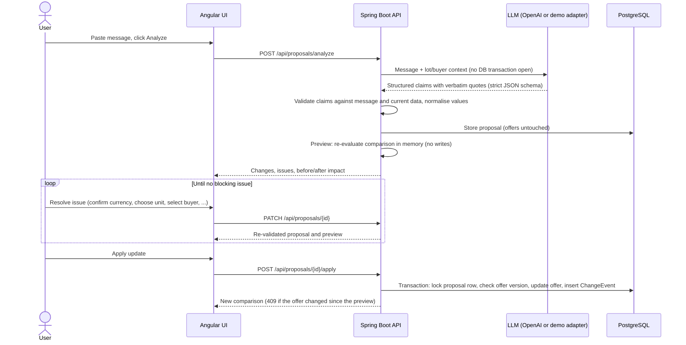
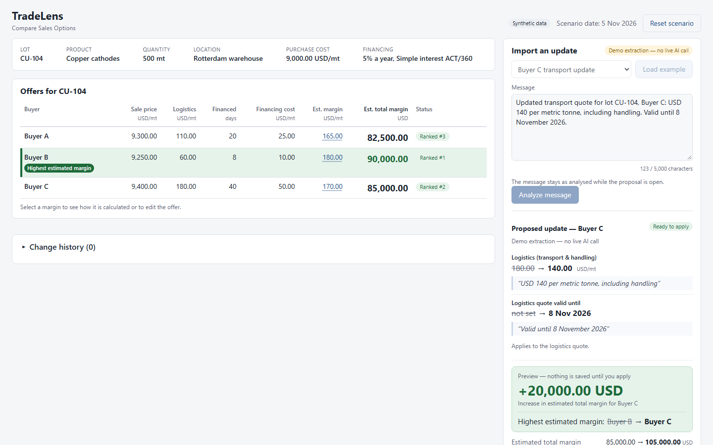
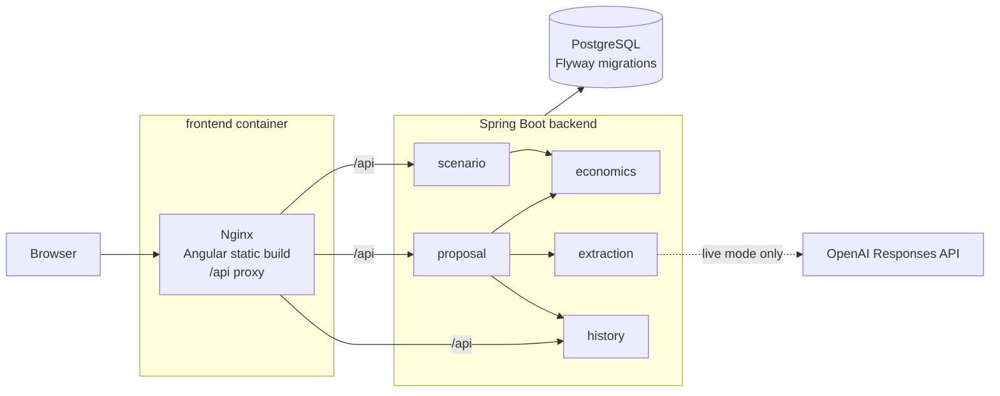

# TradeLens - AI-Assisted Sales Comparison

Compare sale offers for a commodity lot on estimated margin, and turn unstructured commercial messages into reviewable, user-confirmed update proposals.

[](https://github.com/LorencMarkja/tradelens/actions/workflows/ci.yml)
[](LICENSE)

## Problem

Three buyers bid for the same copper lot (CU-104, 500 mt). The highest sale price is not necessarily the highest margin: the seller pays logistics, and capital is tied up until payment, so financing cost (ACT/360 simple interest) depends on the number of days. In the initial scenario Buyer C offers the highest price, but Buyer B has the highest estimated margin.

Commercial updates, such as a new freight quote, arrive as free-text messages. Before they affect a decision they must become structured, verified and traceable data: right lot, right buyer, right currency and unit, with the source text attached and an explicit confirmation by the user.

All data is synthetic.

## How it works





### Responsibility split

| Concern | LLM | Backend |
|---------|-----|---------|
| Reading the message | Interprets free text into schema-constrained claims (field, value, currency, basis, handling, buyer, lot), each with a verbatim quote | Verifies that every quote is a substring of the message and that each number appears in its quote |
| Scope | — | Checks lot, buyer, currency (USD only), basis (per mt or total lot) and handling inclusion |
| Untrusted content | Has no tools, does no arithmetic, makes no decisions and cannot write | Detects instructions phrased as data, payment terms passed off as financing days, and messages touching several offers |
| Normalisation | — | Converts a total-lot cost to per mt (÷ 500) |
| Economics | — | Computes in `BigDecimal` (DECIMAL128, HALF_UP only for display), ranks on unrounded values, handles ties |
| Consistency | — | Optimistic locking on offers (409 on a stale proposal), idempotent apply with a pessimistic row lock on the proposal, change history |
| Decision | None | Presents issues and the preview; applies a change only after the user has resolved every blocking issue and confirmed |

## Architecture



- `economics`: pure margin, ranking, tie and threshold logic. No Spring, no persistence.
- `scenario`: lot and offers, synthetic seed (`DemoSeed`), `GET /api/scenario`, `POST /api/demo/reset`.
- `extraction`: `ExtractionPort` with a demo adapter (12 canned samples) and an OpenAI adapter (Responses API, strict JSON schema, 30 s timeout, no retries).
- `proposal`: analyse, manual edit, corrections, preview, apply and discard; `ProposalValidator` applies field, reference and source-text checks to the extracted claims.
- `history`: `ChangeEvent` with before/after values, source message, original extraction, corrections, model and prompt version.

Design details: [docs/architecture.md](docs/architecture.md). API: [docs/openapi.yaml](docs/openapi.yaml). Guided tour: [docs/walkthrough.md](docs/walkthrough.md).

## Quick start

Prerequisite: Docker (Docker Desktop on Windows and macOS).

```bash
docker compose up --build
```

Open <http://127.0.0.1:8081>. The app starts in **demo mode**: no API key is needed, and only the 12 sample messages are recognised. Use **Reset scenario** in the header to restore the initial offers and clear the history. Stop with `docker compose down` (add `-v` to delete the database volume).

**Live mode.** Copy `.env.example` to `.env`, set `AI_MODE=live`, `OPENAI_API_KEY` and `OPENAI_MODEL`, then recreate the application containers with `docker compose up -d --build --force-recreate backend frontend`. In live mode the backend refuses to start unless both a key and a model are set, and it never falls back silently to demo mode.

| Variable | Default | Meaning |
|----------|---------|---------|
| `AI_MODE` | `demo` | `demo`: canned extractions, no external call. `live`: one OpenAI Responses API call per analysed message. |
| `OPENAI_API_KEY` | — | Required in live mode. Read only by the backend, never sent to the browser or logged. |
| `OPENAI_MODEL` | — | Required in live mode. Must support Structured Outputs. Verified: `gpt-4.1-mini`. |
| `DEMO_SCENARIO_DATE` | `2026-11-05` | Fixed date used to evaluate offer and quote validity. |
| `APP_PORT` | `8081` | Host port of the web app, bound to 127.0.0.1. |

## Economic model and assumptions

```text
Financing cost per mt    = financed capital per mt × annual rate × financing days / 360
Estimated margin per mt  = sale price − purchase cost − logistics cost − financing cost
Estimated total margin   = estimated margin per mt × lot quantity
Logistics threshold      = sale price − purchase cost − financing cost − best competing margin per mt
```

Lot terms: CU-104, copper cathodes, 500 mt, purchase cost 9,000 USD/mt, financed capital 9,000 USD/mt, 5 % a year (ACT/360).

| Buyer | Sale price (USD/mt) | Logistics (USD/mt) | Financing days | Financing (USD/mt) | Margin (USD/mt) | Total margin (USD) |
|-------|--------------------:|-------------------:|---------------:|-------------------:|----------------:|-------------------:|
| A | 9,300 | 110 | 20 | 25.00 | 165.00 | 82,500.00 |
| B | 9,250 | 60 | 8 | 10.00 | 180.00 | **90,000.00** |
| C | 9,400 | 180 | 40 | 50.00 | 170.00 | 85,000.00 |

Assumptions:

- The whole lot is sold to one buyer.
- USD only.
- The seller pays logistics (transport and handling).
- Financing days are capital immobilisation, not payment terms.
- A missing input is never treated as zero: the offer is excluded from the ranking as `INCOMPLETE`.
- An offer or logistics quote that has expired at the fixed scenario date is excluded as `EXPIRED`.

## Testing

```bash
# Backend: unit tests and integration tests on real PostgreSQL (Testcontainers; Docker must be running)
cd backend
./mvnw test                      # Windows: .\mvnw.cmd test (JDK 21 in JAVA_HOME)
cd ..

# End-to-end (Playwright, Chromium) against the compose stack in demo mode
docker compose up --build -d     # with AI_MODE=demo
cd frontend
npm ci
npx playwright install chromium
npm run e2e                      # E2E_BASE_URL overrides http://127.0.0.1:8081
```

| Suite | Covers |
|-------|--------|
| `ComparisonEngineTest` | Initial results, ranking, ties, sub-cent differences, threshold, zero and negative values, DECIMAL128 precision and HALF_UP display rounding, incomplete and expired offers |
| `ExtractionOutputParserTest` | Schema-invalid AI output, consistency of the demo samples, demo mode limited to the samples, message delimiters, current prompt and schema |
| `ProposalValidatorTest` | Instruction detection: commands vs ordinary quoted values |
| `ProposalFlowTest` | Full API flow on PostgreSQL: every sample case, quote and value verification, injected instructions, AI failures, side-effect-free analysis and preview, idempotent apply, stale proposals (409), corrections, expiry, manual edits, reset |
| `e2e/demo-path.spec.ts` | Message → extraction → preview → apply → new ranking → history; an ambiguity case; the calculation detail; layout at 1440×900 |

Tests never call the paid API: integration tests replace the adapter with a scriptable fake (`ScriptedExtractionPort`). CI ([`.github/workflows/ci.yml`](.github/workflows/ci.yml)) runs the backend suite and a production frontend build on every push and pull request to `main`.

## Limitations

- Local application only, with no authentication. Publishing this source repository does not deploy the application.
- Schema and source-text checks do not guarantee semantic correctness or complete prompt-injection protection. Review extracted values before applying updates.
- Single lot and USD only: no FX, hedging, credit risk or taxes.
- The result is an estimated margin on the modelled costs, not net profit or a commercial recommendation.
- The history is an application trace, not a certified or immutable audit trail.
- Live mode has been verified with `gpt-4.1-mini` only.
- Transient OpenAI errors (429, 503, timeouts) are surfaced with **Try again**; there are no automatic retries.

## Tech stack

| Area | Version |
|------|---------|
| Java | 21 (Temurin 21.0.13) |
| Spring Boot | 4.1.2 |
| Hibernate ORM | 7.4 |
| Flyway | 12.4 |
| Jackson | 3 |
| OpenAI Java SDK | 4.100.0 |
| Testcontainers | 2.0.5 |
| PostgreSQL | 17.11 |
| Angular | 21.2 |
| TypeScript | 5.9 |
| Playwright | 1.64.1 |
| Nginx | 1.30.6 |
| Maven | 3.10.0 (wrapper) |

Exact frontend versions are pinned in `frontend/package.json` and `frontend/package-lock.json`.

## Project structure

```text
backend/                Spring Boot API
  src/main/java/.../    economics, scenario, extraction, proposal, history, common
  src/main/resources/   Flyway migration, extraction prompt and schema (v1), demo samples
frontend/               Angular app, Nginx config, Playwright tests (e2e/)
docs/                   architecture.md, walkthrough.md, openapi.yaml
.github/workflows/      CI
compose.yaml            db, backend, frontend
.env.example            configuration template
```

## License

[MIT](LICENSE)
